# Focus Blocker

<p align="center"></p>

FocusBlocker is a desktop focus app for macOS and Windows. It lets you collect distracting websites and apps into named blocklists, start timed focus sessions or recurring schedules, and add optional accountability locks. Its Chrome extension applies website rules in Chrome and communicates with the desktop app through a native messaging host.

FocusBlocker is an independent implementation. It is not affiliated with or endorsed by Cold Turkey or any other focus-blocking product.

> **Platform status:** The macOS app supports macOS 13 or later on Apple silicon. The Windows x64 app is a separate implementation built with .NET 10 and WPF. Features and setup details can differ by platform.

<p align="center"></p>

## Install

### macOS (Apple silicon, macOS 13 or later)

```sh
curl -fsSL https://raw.githubusercontent.com/aman9560/FocusBlocker/main/install-mac.sh | bash
```

This downloads the latest release, installs `FocusBlocker.app` into `/Applications`, registers the Chrome connection and opens the app. It avoids macOS's "Apple cannot check it for malicious software" warning: that warning comes from the flag a **web browser** puts on downloaded files, and `curl` doesn't set it (the script also clears it). FocusBlocker is signed ad hoc rather than with a paid Apple Developer ID, so a DMG downloaded in a browser will be flagged; if you prefer the DMG, drag the app to Applications and run `xattr -dr com.apple.quarantine /Applications/FocusBlocker.app` once. Read [install-mac.sh](install-mac.sh) first if you like; `./install-mac.sh --help` lists its options.

macOS still asks you to approve two things yourself: allow the background agent in **System Settings → General → Login Items** (use *Turn on agent* under Protection), and, for Chrome, load the extension (see below).

### Windows (10 or 11, x64)

```powershell
irm https://raw.githubusercontent.com/aman9560/FocusBlocker/main/install-windows.ps1 | iex
```

This downloads the latest release ZIP, installs it under `%LOCALAPPDATA%\Programs\FocusBlocker`, adds a Start Menu shortcut, registers the Chrome connection and starts the app. No administrator rights are needed. It avoids the SmartScreen "Windows protected your PC" warning the same way: `Invoke-WebRequest` doesn't add the "downloaded from the internet" mark, and the script clears it from everything it installs.

Both installers refuse to update while a focus session is running, because replacing the app would stop the background agent that enforces it. Your blocklists, schedules and history are kept.

## What FocusBlocker does

### Website and application blocklists

Create named blocklists for different contexts, such as studying, work, or sleep. A list can contain:

- **Websites:** enter a domain such as `reddit.com` to cover that domain and its subdomains. Add a path such as `youtube.com/shorts` to target part of a site.
- **Exceptions:** allow specific sites or paths through a broader website rule. When multiple active lists apply, an exception does not override a block from another list.
- **Applications:** choose apps on macOS by their bundle identity. On Windows, add process names for applications the background agent should ask to close.

You can maintain multiple lists and select more than one for a session or schedule. The app also supports importing supported website lists from text files and compatible JSON exports. Unsupported entries are skipped rather than guessed; encoded Cold Turkey exports are not supported.

### Timed focus sessions

Start a session by choosing one or more blocklists, setting a duration, and selecting the lock behavior. Sessions can run for up to 12 hours. Active sessions continue to be enforced if you close the main app window, provided the background agent is running.

A **strict** session protects the active rules from being weakened through ordinary app controls. While a strict session is active, FocusBlocker restricts edits to its blocklists and schedules that would reduce protection.

### Accountability options

Choose how easy it should be to end a session:

- **Unlocked:** stop the session through the normal controls.
- **Timer lock:** the session runs until its timer finishes; the normal stop control cannot end it early.
- **Password lock:** ending early requires the accountability password.

The password is optional and can be set in Protection. FocusBlocker stores a salted password hash, not the plain-text password, and temporarily delays repeated incorrect attempts. These controls add friction and accountability; they do not make the app tamper-proof against someone with administrator access.

### Weekly schedules

Create recurring schedules by choosing the days, start and end times, blocklists, and lock behavior. A schedule starts a session when its time window begins and ends it when the window finishes. Schedules are useful when you want focus periods to happen automatically without starting each one by hand.

### Chrome website blocking

Website rules in Chrome require the separate FocusBlocker extension and a registered native messaging host. The extension receives the current policy from the desktop app and applies matching rules in Chrome. During strict website sessions, the desktop app checks that the extension is responding; if it stops responding, FocusBlocker may ask Chrome to close. Depending on Protection settings, strict website sessions can also ask other browsers to close.

**The Chrome extension is not installed by the macOS DMG or Windows EXE.** Install it separately using the [Chrome extension setup guide](Assets/CHROME-EXTENSION-INSTALL.md). The extension is not currently published in the Chrome Web Store, so Chrome's **Load unpacked** flow and Developer mode are required.

- On macOS, download and extract the [Chrome extension ZIP](https://github.com/aman9560/FocusBlocker/releases/latest), load its folder in Chrome, then register the native host using the command in the setup guide.
- On Windows, download the complete **Windows x64 ZIP**, run the app and choose **Install Chrome host**, then load the ZIP's `extension` folder in Chrome. The standalone EXE does not include the extension and native host.

Keep the extracted extension folder in place after loading it. Chrome needs that folder to remain available.

### Activity and emergency failsafe

FocusBlocker keeps a local activity history of session starts and ends, password attempts, and failsafe actions. The log is integrity-chained so edits to individual entries can be detected. This does not prevent an administrator from deleting the entire local log.

If you need to stop a locked session, use **Emergency end active blocks** in the app. The failsafe ends active sessions immediately, records the action, and preserves your blocklists, schedules, passwords, and settings. It does not delete the app or configuration. A scheduled session will wait until its next scheduled occurrence before starting again.

## Getting started

1. Download the macOS package or Windows x64 build from [Latest Release](https://github.com/aman9560/FocusBlocker/releases/latest).
2. Open FocusBlocker and create one or more blocklists.
3. Add websites, exceptions, and applications to each list.
4. (Optional) Set an accountability password and configure background enforcement in **Protection**.
5. Start a timed session, or create a weekly schedule.
6. To block websites in Chrome, follow the separate [extension setup guide](Assets/CHROME-EXTENSION-INSTALL.md).

For Windows installation steps and platform-specific behavior, see [Windows setup and limitations](Windows/README.md).

## How enforcement works and its limits

The background agent checks active policy and asks blocked applications to close gracefully; it does not force-terminate them. On macOS, the agent runs as a per-user background service. On Windows, you can enable the optional agent to run at sign-in and continue enforcement while the main window is closed.

FocusBlocker is designed to make distractions harder to reach and to make bypasses more deliberate. A user with sufficient access to the computer can stop the agent, change local files, disable or remove the browser extension, or uninstall the app. It does not install a tamper-proof driver, control the network firewall, or prevent an administrator from bypassing it. Browser website blocking currently requires the Chrome extension; installing the desktop app alone does not block websites in browsers.

## Privacy and local data

FocusBlocker keeps its settings, blocklists, schedules, sessions, and activity history on the device. The app does not require a FocusBlocker account or cloud sync. The Chrome extension communicates with the local desktop app through Chrome native messaging so it can read active website rules and report its connection status.

## Build from source

### macOS

The macOS build requires the Swift compiler and Apple Command Line Tools:

```sh
./build.sh test   # builds the engine, runs the Swift and extension tests
./build.sh app    # assembles .build/FocusBlocker.app
./install-mac.sh --app .build/FocusBlocker.app
```

The local build is ad-hoc signed and is not notarized for distribution.

### Windows

The Windows app is a separate .NET 10/WPF project. See [Windows setup and limitations](Windows/README.md) for platform notes.

```sh
dotnet run --project Windows/FocusBlocker.Tests -c Release   # engine, process rules, and the real Chrome host process
```

The tests run on any OS with the .NET 10 SDK. The WPF app itself only runs on Windows. On macOS or Linux it compiles when you add `-p:EnableWindowsTargeting=true`.

Review the source code before enabling background enforcement or browser integration.

## Downloads

Get the macOS app, Windows builds, and separate Chrome extension ZIP from [Latest Release](https://github.com/aman9560/FocusBlocker/releases/latest).
