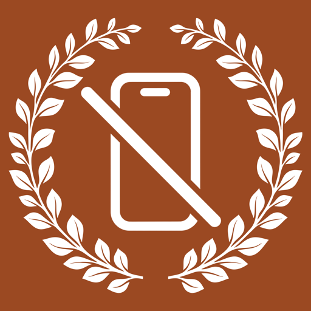

# Focus Blocker

# ⚠️ CHROME EXTENSION: SEPARATE MANUAL INSTALL REQUIRED ⚠️

**Installing the Mac DMG or Windows EXE does NOT install the Chrome extension.** Chrome requires a separate extension install. This extension is **not currently published in the Chrome Web Store**. To use website blocking, follow the step-by-step [Chrome extension install guide](Assets/CHROME-EXTENSION-INSTALL.md). You can also download the [extension ZIP](https://github.com/aman9560/FocusBlocker/releases/latest) separately.

On Windows, use the full ZIP for Chrome support; the standalone EXE alone does not include the extension or native host. On macOS, install the extension from its ZIP, then register the native host using the command in the install guide.

---

FocusBlocker is an independent focus tool for macOS and Windows. It is not affiliated with or endorsed by any other focus-blocking product.

> **Status:** early development. The macOS app targets macOS 13 or later on Apple silicon. Windows is a separate x64 implementation with schedules, accountability locks, import, activity history, background enforcement, and Chrome integration. See [Windows setup and limitations](Windows/README.md).



## Features

- Timed focus sessions with optional accountability password
- Recurring schedules and website blocklists
- Chrome extension integration through a native messaging host
- Optional background agent for app and browser enforcement
- Local activity log and import of supported blocklist formats
- Emergency failsafe to end active sessions while preserving all saved configuration

Enforcement on a personal administrator account is intended to add friction and make casual bypasses visible. It cannot prevent an administrator from stopping or removing the software.

## Build

The current build script uses the Swift compiler directly and requires the macOS Command Line Tools:

```sh
./build.sh
./build.sh app
```

`./build.sh app` assembles `.build/FocusBlocker.app`. The app is ad-hoc signed for local use; it is not notarized for distribution. Review the relevant source code before enabling the optional background agent or browser integration.

During an active session, choose **Emergency end active blocks** in the app, or run `/Applications/FocusBlocker.app/Contents/Helpers/focusctl failsafe-end` in Terminal and confirm with `y`. This ends active sessions, records the action, and keeps blocklists, schedules, passwords and settings.

## Browser extension

Chrome's **Load unpacked** flow is required for the current extension build. Read the prominent setup guide above before trying to connect Chrome. The extension's public manifest key pins its development ID. The matching private signing key is intentionally not included in this repository.

## Platform support

The repository includes the macOS app and a separate Windows implementation. Download the macOS DMG or ZIP, Windows EXE, Windows setup ZIP, or the separate Chrome extension ZIP from [Latest Release](https://github.com/aman9560/FocusBlocker/releases/latest). The Windows ZIP is needed for Chrome integration because it includes the native host and extension files.
